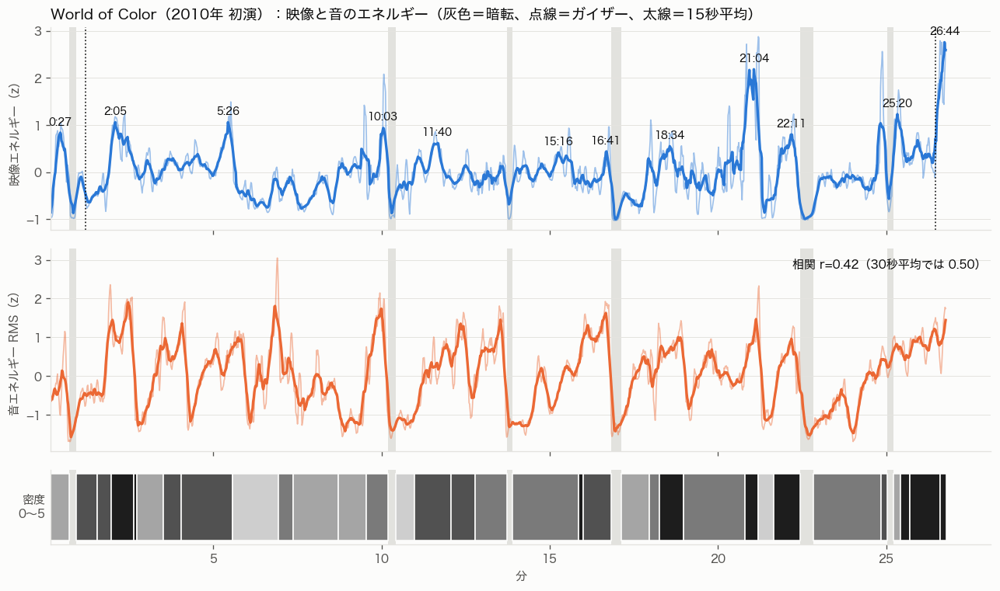
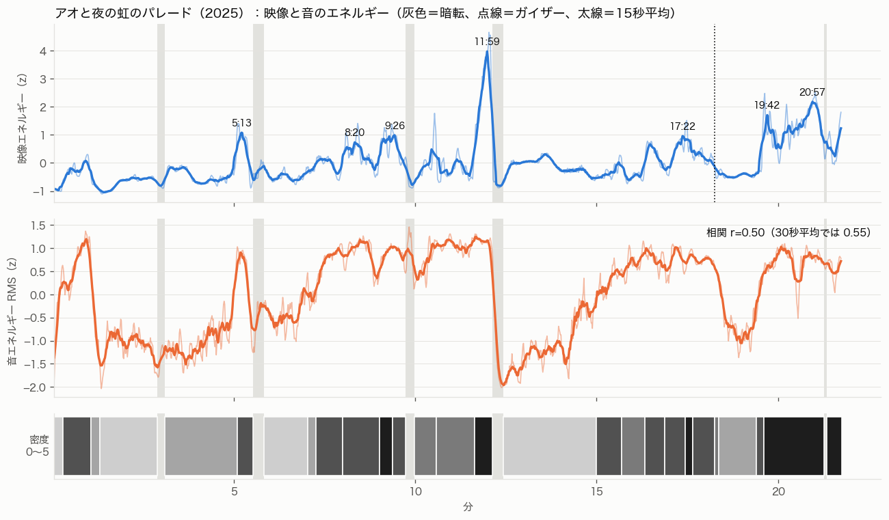

# 多場面ナイトショーの構成を数値で見る（2026-10-26）

docs/video-review.md（WoC ONE の見た目）の「1場面1色＋差し色」「暗転」「大技は山場だけ」を、別の2本で数値にして確かめ、3分ショーに縮める案を出す。

## 結論（先に）

1. **場面の長さは平均46秒、中央値36〜40秒**。2本とも平均が45.7秒で一致した。ばらつきは大きく（標準偏差30〜35秒）、6〜16秒の「一撃」と90秒以上の「長い場面」が各4〜6個ずつ混ざる
2. **全機材が同時に動くのは全体の約15%**（WoC 15.6%、万博 14.4%）。逆に「ほぼ止めて投影だけ」の時間は WoC 9%、万博 26%
3. **完全な暗転は約5%**（WoC 6回・計89秒、万博 5回・計67秒）。1回10〜23秒。これとは別に、一撃の直前に**3〜7秒の短い暗**が2〜3分に1回ある
4. **3色以上を同時に出す時間は1割前後**（WoC 12%、万博 8%）。それ以外は1色か「1色＋差し色」か2色。フィナーレの多色は「同時の虹」ではなく、**全面を2秒ごとに単色で切り替える**形で、2本とも同じだった
5. **最大の山は後半**（WoC 78%と99%、万博 55%と96%）。最大の山の前には、密度2〜3の「溜め」が60〜120秒ある
6. **ガイザー級の単独の高い柱は1本のショーで1〜2回**だけ（WoC は序盤4%と最後99%、万博は84%）
7. 映像と音の強さの相関は r=0.42〜0.50（30秒平均で0.50〜0.55）。大きな一撃は音の拍と同じ瞬間（±0.2秒）が多い。盛り上がりは「音が先に上がり始め、水が数秒遅れて満ちる」傾向があるが、弱い（推測）

## 1. 対象と測り方

| 略称 | 映像 | 長さ（本編） | 撮り方 |
| --- | --- | --- | --- |
| WoC 2010 | [World of Color world premiere full show（Inside the Magic, 2010-06-11 公開）](https://www.youtube.com/watch?v=7o0Icz6ExiM) | 27:19（本編 0:10–26:47 = 26分37秒） | 客席からのほぼ固定の撮影。ズームをときどき変える |
| 万博 | [【大阪・関西万博】水と空気のスペクタクルショー「アオと夜の虹のパレード」[4K]（FesDanMoon, 2025-04-29 公開）](https://www.youtube.com/watch?v=5SMld0OusMg) | 23:54（本編 0:03–21:45 = 21分42秒、その後74秒のカーテンコール） | 最前列中央付近からの手持ち。キャラクターを追って左右に振る場面がある |

万博は公式アーカイブ（rBrqqwsNKWg）もあるが、編集されたカメラ割りなので、客席の固定に近い上の映像を使った。360p でダウンロードした。

**機械で測ったもの**（1秒ごと、`scripts/measure.py`）：平均輝度、明るい画素（輝度0.25以上・0.6以上）の割合、彩度の高い画素の色相ヒストグラム（30°×12区分）と「12%以上を占める色相の数」、0.2秒ごとのコマ差（動き）。音はモノラル11kHz にして RMS と スペクトルフラックス（オンセットの強さ）。**映像エネルギー**＝（光っている面積・明るい面積・動き）の z 値の平均。**音エネルギー**＝RMS の z 値。

**目で見たもの**：2秒ごとのコマのタイル（WoC 28枚、万博 24枚）を全部見て場面を切り、区切りは「前後3秒の明るさ・色・動きの差」が最大の秒へ寄せた。暗転は「光っている面積が5%未満（万博は背景の大屋根リングが光るので12%未満）が3秒以上」で機械的に拾い、目で確かめた。

**注意**：
- 色相の数は、WoC では水幕の投影、万博では背景の大屋根リング（常にオレンジと紫に光る）に引っぱられる。**色の判定は目で見た表を正とし、機械の値は補助**にした
- カメラの自動露出とズーム（WoC）、手持ちの振り（万博）で輝度が動く。秒単位の細かい値より、場面単位・30秒単位の傾向を見る
- 音は客席の録音なので、歓声・炎の音・拍手が混ざる
- 「密度」は目で付けた0〜5：0＝消灯、1＝投影か低い点灯だけ、2＝一部の機材、3＝主な機材2〜3種、4＝ほぼ全幅、5＝全機材＋高さも最大

## 2. World of Color（2010年 初演）

映画ごとの場面を、投影と噴水で順に見せる構成。場面名の映画は投影の絵から判断した（「緑の森」「魔物」「緑と赤の投影」は作品を確定できていない）。

| # | 時刻 | 長さ | 場面と音 | 主な色 | 機材 | 水幕 | 密度 | 入り方 |
|---|---|---|---|---|---|---|---|---|
| 1 | 0:10–0:43 | 33秒 | 開幕：サーチライト・観覧車・白い柱（音:静） | 黄白＋赤 | chaser白柱・レーザー・観覧車 | なし | 2 | — |
| 2 | 0:55–1:33 | 38秒 | 序曲：多色のもや→青→中央の大柱→アーチ（音:静） | 多色→青＋紫 | grid・geyser・whipアーチ | なし | 4 | 暗転から |
| 3 | 1:33–1:58 | 25秒 | 赤の場面（フラワー・扇・whip）（音:中） | 赤1色 | flower・fan・whip・低い列 | なし | 4 | カット |
| 4 | 1:58–2:38 | 40秒 | 紫青の大グリッド＋レーザー（音:強） | 紫青＋ピンク | grid全列・whip・レーザー | なし | 5 | カット |
| 5 | 2:38–2:44 | 6秒 | 緑一色の全面（音:静） | 緑1色 | grid全列 | なし | 5 | カット |
| 6 | 2:44–3:30 | 46秒 | 人魚バラード：水幕の投影（音:静） | 赤＋青 | 水幕・低いgrid | 中央の大幕 | 2 | カット |
| 7 | 3:30–4:03 | 33秒 | 人魚：青一色の全面（音:強） | 青1色 | grid全列・fan | 背面に薄く | 4 | クロスフェード |
| 8 | 4:03–5:34 | 91秒 | アンダー・ザ・シー（多色）（音:中） | 多色（4色以上） | whip・chaser・投影 | 大幕 | 4 | クロスフェード |
| 9 | 5:34–6:56 | 82秒 | ニモ：青のドーム→水幕だけ（音:中） | 青＋橙（魚） | fanドーム→ほぼ停止 | 大幕 | 1 | カット |
| 10 | 6:56–7:22 | 26秒 | 海中（青）（音:中） | 青＋緑 | grid・投影 | 大幕 | 3 | クロスフェード |
| 11 | 7:22–8:43 | 81秒 | WALL-E：宇宙（紫・暗）（音:静） | 紫青＋橙の差し | 低いgrid・投影 | 大幕 | 2 | カット |
| 12 | 8:43–9:33 | 50秒 | トイ・ストーリー：投影＋赤の低い列（音:静） | 赤（低い列）＋投影色 | 低いchaser | 大幕 | 2 | クロスフェード |
| 13 | 9:33–10:11 | 38秒 | 緑レーザーと白柱（音:強） | 緑＋白 | grid高い列・レーザー | 大幕 | 3 | カット |
| 14 | 10:26–10:58 | 32秒 | Up：暗→風船→家（音:静） | 多色（投影）＋青の点 | 低い点灯のみ | 大幕 | 1 | 暗転から |
| 15 | 10:58–12:04 | 66秒 | オーロラ→紫青のアーチ→宮殿（音:中） | 赤黄→紫青 | whip・アーチ・grid | 大幕 | 4 | カット |
| 16 | 12:04–12:47 | 43秒 | 紫ピンクのアーチ＋月（音:中） | 紫ピンク＋橙の差し | whipアーチ・grid | 大幕 | 4 | クロスフェード |
| 17 | 12:47–13:44 | 57秒 | ジーニー：青投影＋赤whip（音:強） | 青＋赤 | whip・低いgrid | 大幕 | 3 | カット |
| 18 | 13:54–15:51 | 117秒 | 緑の森：葉・滝・虹（音:静） | 緑＋青 | grid・レーザー | 大幕 | 3 | 暗転から |
| 19 | 15:51–16:00 | 9秒 | 赤→白→青の全面一撃（音:中） | 単色を2秒で3回 | grid全列 | なし | 5 | カット |
| 20 | 16:00–16:50 | 50秒 | 青→ピンク紫の扇とアーチ（音:強） | 青→ピンク紫 | fan・whipアーチ・高い列 | 中幕 | 4 | カット |
| 21 | 17:08–17:57 | 49秒 | 緑と赤の投影・青の低い列（音:静） | 青＋緑赤の投影 | 低いgrid | 大幕 | 2 | 暗転から |
| 22 | 17:57–18:16 | 19秒 | 多色の短い切替→骸骨（音:中） | 青→黄→緑 | grid | 大幕 | 3 | カット |
| 23 | 18:16–18:58 | 42秒 | 海賊：赤一色の全面（音:強） | 赤1色 | grid全列・flower・爆発 | なし | 5 | カット |
| 24 | 18:58–20:48 | 110秒 | 魔物：赤と青・投影（音:中） | 赤＋青 | 低い列・投影 | 大幕 | 3 | クロスフェード |
| 25 | 20:48–21:11 | 23秒 | 炎（音:強） | 橙（炎） | 火炎 | なし | 5 | カット |
| 26 | 21:11–21:39 | 28秒 | 緑の静けさ（ほぼ暗）（音:静） | 緑1色 | ほぼ停止 | 薄く | 1 | カット |
| 27 | 21:39–22:27 | 48秒 | 赤白→黄→赤の全面（音:中） | 赤＋白→黄→赤 | grid全列・高い列 | 大幕 | 5 | クロスフェード |
| 28 | 22:50–24:51 | 121秒 | ラブソング・メドレー（音:静） | 青紫＋投影の多色 | whipアーチ | 大幕 | 3 | 暗転から |
| 29 | 24:51–25:02 | 11秒 | 白の全面→青レーザー（音:強） | 白→青 | grid全列・レーザー | なし | 4 | カット |
| 30 | 25:13–25:26 | 13秒 | つなぎの投影（音:強） | 紫 | 投影 | 大幕 | 2 | 暗転から |
| 31 | 25:26–25:42 | 16秒 | フィナーレ1：2秒ごとの色替え（音:中） | 単色を2秒ごとに5回 | grid全列 | なし | 5 | カット |
| 32 | 25:42–26:36 | 54秒 | フィナーレ2：多色投影＋全面（音:強） | 多色→紫ピンク | 全機材・geyser | 大幕 | 5 | クロスフェード |
| 33 | 26:36–26:47 | 11秒 | 締め：炎→青全面（音:強） | 橙→青 | 火炎・grid全列 | なし | 5 | カット |

**数値**

| 項目 | 値 |
| --- | --- |
| 場面数 | 33（暗転を除く） |
| 場面の長さ | 平均45.7秒、標準偏差30.4秒、中央値40秒、四分位 25〜54秒。15秒以下が5場面、90秒以上が4場面 |
| 暗転 | 6回、計89秒（本編の5.6%）。長さ 12・15・10・18・23・11秒。位置 0:43, 10:11, 13:44, 16:50, 22:27, 25:02 |
| 短い暗（3〜7秒） | 約12回（例：1:46–1:51 赤の場面の途中、21:35–21:41 赤の全面の直前） |
| 入り方 | カット18、クロスフェード8、暗転から6 |
| 全機材（密度5） | 15.6%（9場面）。密度1以下は8.9% |
| 四半期ごとの平均密度 | 3.1 → 2.7 → 3.3 → 3.7 |
| 色（時間の割合） | 1色または1色＋差し色 41%、2色 42%、3色以上 12%（3色以上は4場面：序曲の頭、アンダー・ザ・シー、Up の風船、フィナーレ2） |
| ガイザー級の単独の柱 | 2回：1:12（本編の4%、序曲で中央の青い大柱だけを立てる）、26:28（99%、フィナーレ） |
| エネルギーの山（15秒平均、±45秒の極大） | 12個。大きいもの：2:05（7%）、5:26（20%）、21:04（78%、炎）、25:20（95%）、26:44（99.8%、締め） |
| オープニング | 33秒（＋暗転12秒＋序曲38秒）。最初の全面（密度5）は1:58（本編の7%） |
| フィナーレ | 25:26–26:47 の81秒（5.1%）。2秒ごとに全面の色を替える16秒→多色54秒→炎と青の全面11秒 |
| 映像と音の相関 | r=0.42（5秒平均）、0.50（30秒平均）。全体のずれは0秒が最大。場面ごとの密度と音の強さの相関 0.54 |

**代表コマ**：`shots/show-analysis/v3/woc2010_30.jpg`（開幕の白い柱）、`_76`（序曲の中央の大柱）、`_104`（赤の場面）、`_140`（紫青の大グリッド）、`_186`（水幕の投影）、`_230`（青一色の全面）、`_290`（アンダー・ザ・シーの多色）、`_380`（ニモ：噴水を止めて投影だけ）、`_1110`（海賊：赤一色の全面）、`_1262`（炎）、`_1338`（赤の全面の高い列）、`_1530`（フィナーレ）

**読み取り**
- 26分を「投影の物語（密度1〜3）」と「全面の歌（密度4〜5）」の交互で進める。投影の場面では噴水をほとんど止める（ニモ 82秒、WALL-E 81秒は光っている面積が6〜9%）
- 全面の場面は、ほぼ必ず1色（青・赤・緑）。赤一色の全面は3回（1:33、18:16、21:39）使い、毎回「強い曲」に当てる
- 暗転は、物語の章の変わり目にだけ置く（序曲の前、Up の前、緑の森の前、緑と赤の投影の前、ラブソングの前、フィナーレの前）

## 3. アオと夜の虹のパレード（大阪・関西万博 2025）

中央の門形のモニュメント（ウォーターカスケード、内側が水幕）に少年の物語を投影し、手前の噴水の帯と、左右の霧・高い噴射を組み合わせる。物語の比重が WoC より大きい。

| # | 時刻 | 長さ | 場面と音 | 主な色 | 機材 | 水幕 | 密度 | 入り方 |
|---|---|---|---|---|---|---|---|---|
| 1 | 0:03–0:18 | 15秒 | 開幕：ゲートの点灯ともや（音:静） | 白→青 | ゲート照明のみ | なし | 1 | — |
| 2 | 0:18–1:04 | 46秒 | 青の序曲：全面の波（音:中） | 青1色 | grid全列（波） | なし | 4 | クロスフェード |
| 3 | 1:04–1:19 | 15秒 | ゲート内の光線（音:静） | 青紫 | ムービング光線 | ゲート | 2 | クロスフェード |
| 4 | 1:19–2:54 | 95秒 | 物語1：水幕の人物投影（音:静） | シアン＋青の点 | 低い点灯のみ | ゲート | 1 | クロスフェード |
| 5 | 3:06–5:06 | 120秒 | 物語2：少年と緑の芽（音:静） | 緑＋シアン | 霧スクリーン・緑の造形 | ゲート＋左右の霧 | 2 | 暗転から |
| 6 | 5:06–5:32 | 26秒 | 小さな山：全面＋霧の造形（青紫）（音:中） | 青紫＋白 | grid全列・白い弧・霧 | ゲート | 4 | カット |
| 7 | 5:50–7:02 | 72秒 | 物語3：少年と赤い鳥（音:静） | 緑枠＋赤（鳥） | 低い点灯のみ | ゲート | 1 | クロスフェード |
| 8 | 7:02–7:16 | 14秒 | 白いサーチライトの導入（音:静） | 白 | 光線 | ゲート | 2 | カット |
| 9 | 7:16–8:00 | 44秒 | 歌1：紫青の全面＋鳥（音:強） | 紫青＋黄の投影 | grid全列・光線 | ゲート | 4 | カット |
| 10 | 8:00–9:01 | 61秒 | 紫→緑→青白の色ブロック（音:強） | 単色ブロック（6〜12秒） | grid全列・光線・レーザー | ゲート | 4 | カット |
| 11 | 9:01–9:22 | 21秒 | 山場1：橙と青の交互・V字の高い噴射（音:強） | 橙⇔青 | 高いV字・grid全列・霧 | なし | 5 | カット |
| 12 | 9:22–9:44 | 22秒 | 紫ピンクの全面＋レーザー（音:強） | 紫ピンク | grid・レーザー | なし | 4 | カット |
| 13 | 9:59–10:35 | 36秒 | 火の鳥の投影→紫・橙の一撃（音:中） | 橙→黄→青→紫→橙 | 投影・grid | ゲート | 3 | 暗転から |
| 14 | 10:35–11:38 | 63秒 | 赤一色の霧＋多色投影（音:強） | 赤1色→多色 | 低いgrid・霧・V字 | ゲート | 3 | カット |
| 15 | 11:38–12:08 | 30秒 | 山場2：橙の全面＋火球（音:強） | 橙＋白 | grid全列・火炎・霧 | なし | 5 | カット |
| 16 | 12:26–14:59 | 153秒 | 谷：少年ひとり、噴水ほぼなし（音:静） | 白（照明） | ほぼ停止 | ゲート | 1 | 暗転から |
| 17 | 14:59–15:41 | 42秒 | 緑の波→緑ティールの全面（音:中） | 緑ティール | grid・レーザー・霧玉 | なし | 4 | カット |
| 18 | 15:41–16:20 | 39秒 | 金の火花・太陽と地球（音:中） | 青紫＋金 | grid・投影 | ゲート | 3 | カット |
| 19 | 16:20–16:53 | 33秒 | 緑の大きな羽（霧＋レーザー）（音:強） | 緑→青紫 | 霧の扇・レーザー | 霧 | 4 | カット |
| 20 | 16:53–17:27 | 34秒 | 祝祭：仲間の多色投影（音:中） | 多色 | grid全列・霧の扇 | ゲート | 4 | カット |
| 21 | 17:27–17:39 | 12秒 | 単色全面を2〜4秒で切替（音:強） | 青→ティール→赤→黄 | grid全列 | なし | 5 | カット |
| 22 | 17:39–18:15 | 36秒 | 黄ピンク紫＋霧の扇（音:強） | 黄ピンク紫 | 霧の扇・grid | ゲート | 4 | カット |
| 23 | 18:15–18:22 | 7秒 | 中央の高い柱＋月（音:中） | 白＋赤の列 | geyser | ゲート | 3 | カット |
| 24 | 18:22–19:24 | 62秒 | 虹のアーチ（霧の弧に投影）（音:静） | 青紫の弧＋虹 | 弧状の霧（扇） | 霧の弧 | 2 | クロスフェード |
| 25 | 19:24–19:36 | 12秒 | 霧の大花（音:静） | 紫 | 霧の花 | 霧 | 4 | カット |
| 26 | 19:36–21:16 | 100秒 | フィナーレ：2秒ごとの色替え＋全面（音:中） | 単色を2秒ごと→紫青 | 全機材 | 霧 | 5 | カット |
| 27 | 21:20–21:45 | 25秒 | 最後の山：橙赤の全面→白の全面（音:中） | 橙赤→白 | grid全列・光線 | なし | 5 | 暗転から |

**数値**

| 項目 | 値 |
| --- | --- |
| 場面数 | 27（暗転を除く） |
| 場面の長さ | 平均45.7秒、標準偏差35.1秒、中央値36秒、四分位 21.5〜61.5秒。15秒以下が6場面、90秒以上が4場面（最長は谷の153秒） |
| 暗転 | 5回、計67秒（5.1%）。長さ 12・18・15・18・4秒。位置 2:54, 5:32, 9:44, 12:08, 21:16 |
| 短い暗（3〜7秒） | 約7回。11:35–11:38 は最大の山（11:38）の直前 |
| 入り方 | カット17、クロスフェード5、暗転から4 |
| 全機材（密度5） | 14.4%（5場面）。密度1以下は25.7% |
| 四半期ごとの平均密度 | 2.1 → 3.1 → 2.3 → 4.0 |
| 色（時間の割合） | 1色または1色＋差し色 68%、2色 19%、3色以上 8%（3場面：赤の霧の後半の投影、祝祭、黄ピンク紫） |
| ガイザー級の単独の柱 | 1回：18:15（84%、門の上に白い柱を立て、門に月を投影）。別に、門の上でV字に開く高い噴射が 9:01（42%）・11:06（51%）、霧の大花が 19:24（89%） |
| エネルギーの山 | 7個。大きいもの：5:13（24%、小さな山）、11:59（55%、最大）、19:42（91%）、20:57（96%） |
| オープニング | 61秒（門の点灯15秒＋青の全面46秒）。最初の全面（密度5）は9:01（本編の41%） |
| フィナーレ | 19:36–21:45 の129秒（9.9%）。2秒ごとに全面の色を替え、霧の花を重ねる100秒→4秒の暗→橙赤の全面→白の全面で終わる |
| 映像と音の相関 | r=0.50（5秒平均）、0.55（30秒平均）。全体のずれは0秒が最大。場面ごとの密度と音の強さの相関 0.83 |

**代表コマ**：`shots/show-analysis/v3/expo_40.jpg`（青の序曲）、`_120`（物語：門の水幕だけ）、`_312`（小さな山）、`_440`（歌1）、`_548`（山場1：V字の噴射と大量の霧）、`_710`（山場2：白の全面）、`_800`（谷：噴水を止める）、`_980`（緑の羽）、`_1050`（赤一色の全面）、`_1096`（中央の高い柱と月）、`_1130`（虹のアーチ）、`_1210`（フィナーレ）

**読み取り**
- 最初の9分は物語の説明で、全面は「青の序曲」と5:06の小さな山だけ。全機材の初登場を本編の41%まで取っておく
- 最大の山（11:38–12:08、橙の全面と火球）の直後に、**153秒の谷**（少年がひとりで門に立ち、噴水はほぼ止まる）を置く。音も一番低い。ここで一度ショーを「ゼロ」に戻し、後半をやり直す
- 後半（15:00〜）は色のブロックを短く刻む（緑→青紫→多色→単色切替→黄ピンク紫）。場面の長さが33〜42秒にそろう
- 終盤の「虹」は、霧の弧に虹を投影する62秒の静かな場面で、全面の多色ではない。多色を「絵」として一か所で見せ、全面は単色のまま

## 4. 2本の比較

| 項目 | WoC 2010 | 万博 | ONE（video-review.md、目視） |
| --- | --- | --- | --- |
| 本編の長さ | 26:37 | 21:42 | 約28分 |
| 場面の長さ 平均／中央値 | 45.7／40秒 | 45.7／36秒 | — |
| 暗転 回数／割合 | 6回／5.6% | 5回／5.1% | 複数（12:00、24:00 等） |
| 密度5の割合 | 15.6% | 14.4% | 山場だけ |
| 密度1以下の割合 | 8.9% | 25.7% | 中央だけの場面あり |
| 3色以上の時間 | 12% | 8% | 1〜2場面 |
| ガイザー級 | 2回（4%, 99%） | 1回（84%） | 最大の山場に集中 |
| 最大の山の位置 | 78%（炎）と99% | 55%と96% | 約70%（20:00） |
| 最初の全面 | 7% | 41% | — |
| フィナーレ | 81秒（5%） | 129秒（10%） | — |
| 映像×音の相関（30秒） | 0.50 | 0.55 | — |

違いは「物語の比重」で説明がつく。万博は物語の場面で噴水を止める時間が長く（密度1以下が26%）、その分、全面を後ろへ寄せている。WoC は歌ごとに全面を見せるので、山が12個と多く、間隔は平均2.2分（万博は7個・3.1分）。

## 5. 多場面ショーの構成の共通則

数値は2本の値（＋ONE の目視）から。範囲は2本の値の幅。

1. **場面の長さは30〜60秒が基本、その中に「一撃（6〜16秒）」と「長い場面（90〜150秒）」を少数混ぜる**。均等に切らない
2. **全機材は全体の15%前後だけ**。残りの時間は、1〜3種の機材で見せる
3. **暗転は全体の5%前後、1回10〜20秒**で、章（物語の区切り）の変わり目だけに置く。一撃の直前には3〜7秒の短い暗を置く
4. **色は1場面1色が基本**（1色＋差し色まで含めて41〜68%）。2色を使うときは「投影の色＋噴水の色」のように役割を分ける。3色以上の同時は1割まで
5. **フィナーレの多色は「時間で切り替える」**。全面を2秒ごとに単色で替え、色の数は時間方向に出す。同時の虹は使わないか、絵（霧の弧など）として一か所に
6. **最大の山は全体の55〜80%と、最後の5%に2つ置く**。山の前60〜120秒は密度2〜3で溜める。大きな山の直後に、長い谷か暗転で一度ゼロに戻す
7. **最大の大技（単独の高い柱・炎）は1〜2回**。最後の一発は残す
8. **音の強さと密度をそろえる**（場面単位の相関0.54〜0.83）。大きな一撃は音の拍に合わせる。盛り上がりの立ち上がりは、音が先、水は1〜6秒遅れて満ちる（中央値：WoC +1.5秒、万博 +6秒、推測）
9. **入り方はカットが半分以上**（カット54〜63%、クロスフェード19〜24%、暗転から15〜18%）。色の切り替えはカットで、静かな場面への移りはクロスフェード

## 6. 3分に縮めるなら

26分の「章の数」は3分には入らない。比率（密度5は15%、暗は5%、多色は1割、山は後半）を残し、場面の長さは短くして数を減らす。

| 時刻 | 長さ | 中身 | 色 | 密度 | 機材 |
| --- | --- | --- | --- | --- | --- |
| 0:00–0:12 | 12秒 | 開幕：暗から中央だけ立ち上げる | 1色（白か青） | 1→2 | grid の中央列、水幕なし |
| 0:12–0:45 | 33秒 | 序曲：全幅へ広げ、波を送る | 青＋差し色 | 3→4 | grid 全列、whip のアーチ |
| 0:45–0:48 | 3秒 | 短い暗 | — | 0 | — |
| 0:48–1:20 | 32秒 | 場面A：はっきりした1色の歌 | 赤か緑の1色 | 3〜4 | fan、flower、chaser |
| 1:20–1:48 | 28秒 | 谷：水幕と中央だけ | 2色（投影＋噴水） | 1〜2 | 水幕、低い grid |
| 1:48–1:51 | 3秒 | 短い暗 | — | 0 | — |
| 1:51–2:15 | 24秒 | 山1（全体の62〜75%）：全面の一撃を含む | 橙か赤の1色＋白 | 4→5（約10秒） | 全機材 |
| 2:15–2:30 | 15秒 | 溜め | 1色 | 2 | whip だけ |
| 2:30–2:55 | 25秒 | フィナーレ：全面を2秒ごとに単色で切り替える×4〜5 → 多色 | 時間で多色 | 5 | 全機材、ガイザー1回（2:48ごろ、93%） |
| 2:55–3:00 | 5秒 | 締め：白の全面→暗 | 白 | 5→0 | grid 全列 |

この案の比率：密度5 ≒ 約40秒（22%。短いショーではフィナーレの比重が上がるので、2本の15%より多めになる）、暗 ≒ 6秒＋最後（3〜5%）、多色 ≒ 15秒（8%）、ガイザー1回。

**残すもの**：1場面1色、暗による区切り、密度の谷、後半の山、時間方向の多色フィナーレ、ガイザーは最後に1回。
**捨てるもの**：章ごとの長い物語（90秒以上の場面）、10〜20秒の暗転（3分では長すぎるので3秒に縮める）、山の数（12個→2個）。

## 7. 確度と限界

- 2本とも1回分の客席撮影。カメラのズーム（WoC）と手持ちの振り（万博）で、輝度・動きの値は場面単位でしか信用できない
- 場面の区切りと密度は目で付けた。区切りは機械の変化点に寄せたが、±3秒ほどの誤差がある
- 色の割合は目で付けた分類による。機械の色相数（3色以上の秒：WoC 22%、万博 32%）は投影と背景のリングを含むので、高く出ている
- 「水が音より先か後か」は、16個の一撃のうち6個が±0.2秒で一致し、残りは前後1〜3秒で向きがそろわない。客席の録音に歓声や炎の音が混ざるため、確かなのは「大きな一撃は拍に合わせる」まで
- WoC の映画名は投影の絵から判断した（緑の森・魔物などは未確定）。歌詞は書いていない

## ファイル

- 本文：この文書
- エネルギー曲線：`shots/show-analysis/v3/woc2010_energy.png`、`shots/show-analysis/v3/expo_energy.png`
- 代表コマ：`shots/show-analysis/v3/woc2010_<秒>.jpg`（12枚）、`shots/show-analysis/v3/expo_<秒>.jpg`（12枚）
- 測定スクリプトと生データ：`../video/v3/scripts/`（measure.py, analyze.py, snap.py, hits.py, summ.py）、`../video/v3/out/`（1秒ごとの JSON、場面の定義、集計）
